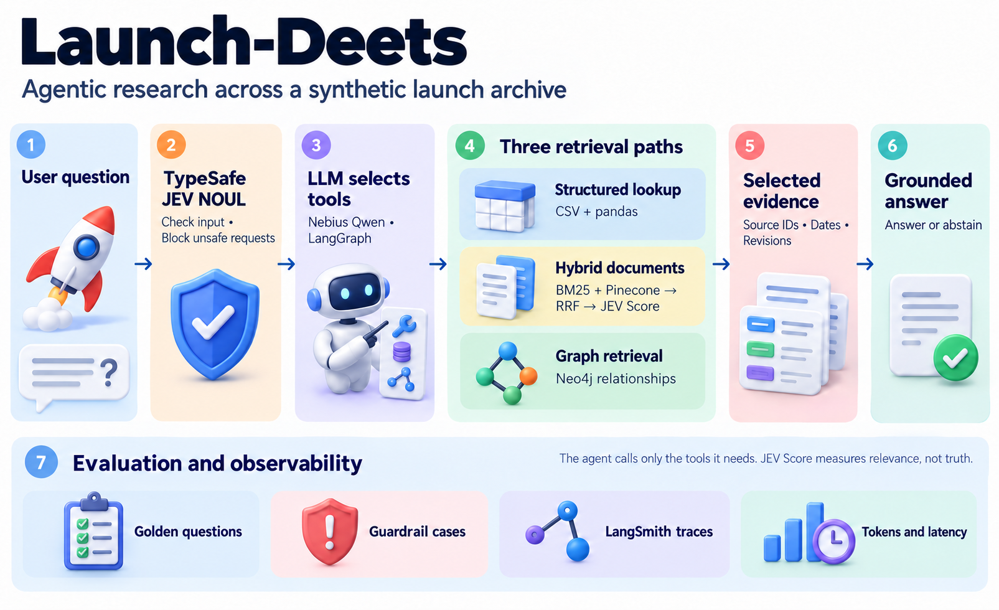

# Launch-Deets

An agentic research application for a **fictional launch and incident archive**. Ask a question in plain language to connect exact records, incident reports, revised findings and corrective actions.



## How it works

1. **Input safety:** TypeSafe JEV NOUL checks the question before retrieval or model generation.
2. **Tool selection:** a Nebius Qwen model, orchestrated with LangGraph, selects the smallest suitable tool set.
3. **Retrieval:**
   - **Structured lookup:** pandas filters and aggregates CSV records.
   - **Hybrid document search:** LangChain BM25 + Pinecone dense retrieval → reciprocal rank fusion → TypeSafe JEV Score reranking.
   - **Graph retrieval:** Neo4j follows component, incident and corrective-action relationships, with a local CSV fallback.
4. **Answer:** the model receives compact evidence and source IDs; unsupported requests can return insufficient evidence. The interface hides citation markers while retaining internal provenance.
5. **Evaluation:** golden questions, guardrail cases, local diagnostics and optional LangSmith traces record quality, token usage and latency.

Each question is independent. The rocket animation indicates progress; it does not indicate that every retrieval tool was called.

## Requirements

- Python 3.12 and [uv](https://docs.astral.sh/uv/).
- Nebius API access for chat and embeddings.
- TypeSafe API access for NOUL and reranking.
- A Pinecone dense index matching the configured embedding dimension.
- Neo4j for hosted graph retrieval (optional; local graph fallback is included).
- LangSmith for hosted tracing and evaluation (optional).

Live requests and ingestion may consume provider credits. No credentials or hosted data are included.

## Install and configure

From the repository root:

```powershell
uv sync --locked --extra ui --extra rag --extra notebook --extra dev
Copy-Item .env.example .env
```

On macOS/Linux, use `cp .env.example .env` for the second command.

Edit `.env` with your own provider credentials. It is ignored by Git. Alternatively set `LAUNCH_DEETS_ENV_FILE` to the absolute path of a private environment file.

| Configuration | Purpose |
|---|---|
| `NEBIUS_API_KEY`, `NEBIUS_BASE_URL`, `NEBIUS_MODEL` | Chat access and selected model |
| `NEBIUS_EMBEDDING_MODEL`, `NEBIUS_EMBEDDING_DIMENSIONS` | Embedding model and matching index dimension |
| `TYPESAFE_API_KEY` | Input safety and relevance reranking |
| `PINECONE_API_KEY`, `PINECONE_INDEX_NAME`, `PINECONE_NAMESPACE` | Hosted document vectors |
| `NEO4J_URI`, `NEO4J_USERNAME`, `NEO4J_PASSWORD` | Optional hosted graph |
| `LANGSMITH_API_KEY`, `LANGSMITH_PROJECT`, `LANGSMITH_TRACING` | Optional traces; set tracing to `true` to enable |

The example configuration uses `Qwen/Qwen3-30B-A3B-Instruct-2507` for chat and `Qwen/Qwen3-Embedding-8B` with 4096 dimensions for embeddings. Choose models available to your account and keep the Pinecone index dimension consistent with the embedding output.

## Prepare the hosted data

Open `notebooks/01_setup_and_walkthrough.ipynb` in VS Code and select this project's `.venv` Python kernel.

1. Run setup, then the provider checks you need.
2. Run **Validate IDs, metadata, and provenance** and inspect the chunks.
3. Run **Upload graph relationships** if using Neo4j.
4. Run **Upload document vectors** to populate Pinecone.
5. Run **Ask the agent** to check an end-to-end request.

This release uses the `launch-deets-synthetic-v1` Pinecone namespace and `LaunchDeetsEntity` Neo4j label. Run ingestion for this release before expecting hosted results. Reingest after changing source documents or chunk settings. Installing the code does not upload data automatically.

## Run the application

```powershell
uv run --no-sync streamlit run streamlit_app.py
```

On Windows you can also run `./START_UI.ps1` after installing. Open `http://localhost:8501`, click the space entrance, then choose **Research**. Select a launch or leave **All launches**, enter a question and click **Start Research**.

## Demo questions

- What was the Alpha telemetry link margin before liftoff?
- What changed in the final Alpha incident analysis?
- Which component was connected to the Charlie yaw incident and what fixed it?
- Who was the pilot of the Alpha launch? (The archive has no pilot identity; expect abstention.)

## Project layout

```text
streamlit_app.py                    Application entry point
START_UI.ps1                        Windows launcher
src/launch_deets/                   Agent, retrieval, providers, configuration and evaluation
ui/                                Entrance, artwork, animation and styles
.streamlit/config.toml              Public UI settings
data/records.csv                   Structured synthetic records
data/documents/                    Synthetic reports with metadata
data/relationships.csv             Graph links and evidence IDs
data/golden_questions.csv          Reference questions and expected facts
data/guardrail_cases.csv           Benign and adversarial inputs
notebooks/                         Setup and stage-by-stage inspection
scripts/                           Evaluation, benchmarking and release scan
tests/                             Offline regression checks
docs/                              Architecture, metadata and evaluation guidance
.env.example                       Blank secrets and public configuration defaults
pyproject.toml / uv.lock            Dependencies and reproducible environment
```

Generated reports are written under `reports/` and ignored by Git.

## Evaluation and limitations

```powershell
uv run --no-sync python -m unittest discover -s tests -v
```

Offline tests mock hosted services. Notebook 02 defaults to local-only mode and separates retrieval diagnostics, live agent calls, judge calls and token accounting. Optional live runs:

```powershell
uv run --no-sync python scripts/evaluate_project.py
uv run --no-sync python scripts/benchmark_project.py
```

These live commands consume provider credits. A saved smoke run answered revision and relationship questions but incorrectly abstained on a major-incident count question. No claim is made that every question passes, that JEV scores measure truth, or that all requests meet a fixed token/latency budget. This is a demonstration; multi-user deployment requires authentication, access controls, rate limits and operational monitoring.

## Data and asset provenance

The 22 records, 17 reports and 30 relationship rows are locally authored synthetic data. Evaluation includes 18 golden questions and 8 guardrail cases. No external launch dataset or course solution kit is bundled. The architecture illustration was AI-generated for this project; it describes the implemented flow and is not an application screenshot.

Read the [architecture](docs/ARCHITECTURE.md), [dataset semantics](docs/DATASET_METADATA.md), and [evaluation notes](docs/EVALUATION.md).

## Before publishing

Run `uv run --no-sync python scripts/check_public_release.py` and inspect `git status` and your staged diff. The scanner checks publication candidates against common secret patterns, configured credentials, personal paths and notebook outputs. It does not certify all possible secrets or external Git history.

Publish **only this repository folder**. Do not upload `.env`, `.venv`, private settings, raw traces, account exports, submission documents or the parent workspace. `.gitignore` excludes these; files already tracked by Git must be removed from tracking separately.

## Licensing

No open-source license has been selected for the original project code. Third-party dependencies retain their own licenses. Course resources are not included. The project name is not a claim of trademark registration or clearance.
